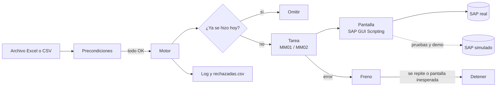

# SAP Material Master Automation

Automatización **supervisada** del maestro de materiales en SAP GUI con Python: la persona elige una tarea, revisa las precondiciones y ejecuta; el script hace en SAP los mismos pasos que haría a mano, con controles pensados para trabajar sobre un sistema productivo.


> **Proyecto de demostración escrito desde cero.** No contiene código, datos, configuraciones ni nombres de ninguna empresa. Los materiales, centros y almacenes son ficticios, y todo se puede probar sin SAP gracias al SAP simulado incluido.

## Qué incluye

| Tarea | Transacción | Qué hace |
|---|---|---|
| Ampliación de almacén | MM01 | Amplía cada material al centro y almacén indicados. Si ya existía, no graba nada |
| Cambio de descripción | MM02 | Reemplaza la descripción corta (máximo 40 caracteres). Si ya era igual, no graba |
| Bloqueo de material | MM02 | Asigna un status de material. No borra: se revierte quitando el status |

Cada tarea lee un Excel o CSV y procesa fila por fila. Agregar una tarea nueva es crear una clase con sus columnas y sus pasos de SAP (ver `src/sap_mm_auto/tareas/`).

## Controles

- **Precondiciones antes de tocar SAP:** el archivo existe y no está abierto en Excel, tiene las columnas requeridas, no tiene filas repetidas y SAP está en la pantalla inicial.
- **Usa la sesión que el usuario ya abrió:** no inicia sesión ni guarda credenciales; todo queda con su usuario y sus permisos.
- **Memoria diaria:** registra cada fila procesada al instante. Si la corrida se corta y se vuelve a lanzar, no repite lo que ya hizo.
- **Una fila con error no detiene la corrida:** queda en un `*_rechazadas.csv` con el motivo, listo para corregir y reprocesar.
- **Freno:** la corrida se detiene si el mismo error se repite tres veces seguidas, si SAP muestra una pantalla inesperada o si la persona pulsa *Detener*.
- **Confirmación explícita** antes de modificar un SAP real.
- **Registro** de cada corrida con hora, fila, resultado y mensaje de SAP.

## Arquitectura



Las tareas nunca hablan con SAP directamente: usan la clase `Pantalla`, que recibe una sesión real (`win32com`) o el SAP simulado. Por eso el mismo código se prueba en cualquier sistema operativo y sin acceso a SAP.

## Probarlo sin SAP

```bash
git clone https://github.com/JeanPierreSP/sap-material-master-automation.git
cd sap-material-master-automation
python -m venv .venv
.venv/Scripts/python -m pip install -e ".[ui,dev]"     # Linux/macOS: .venv/bin/python

# Línea de comandos contra el SAP simulado
sap-mm-auto tareas
sap-mm-auto ejecutar ampliacion_almacen datos_ejemplo/ampliacion_almacen.csv --demo

# Interfaz de escritorio en modo demostración
python -m sap_mm_auto.ui

# Pruebas
python -m pytest
```

## Usarlo con un SAP real

1. Windows con SAP GUI y **SAP GUI Scripting habilitado** en el servidor y en el cliente.
2. Instala la parte de Windows: `pip install -e ".[ui,windows]"`.
3. **Graba los IDs de tus pantallas** con el grabador de scripts de SAP GUI y reemplázalos en `src/sap_mm_auto/tareas/campos.py`. Los incluidos son de ejemplo: cada sistema puede tener otras subpantallas.
4. Prueba primero en un **sistema de calidad**, con pocas filas.
5. Abre SAP, deja la sesión en el menú inicial y ejecuta sin `--demo`. El programa pide confirmación antes de modificar nada.

## Estructura

```
src/sap_mm_auto/
├── sesion.py        Conexión a SAP GUI y operaciones de pantalla
├── controles.py     Memoria diaria, freno y precondiciones
├── motor.py         Bucle común con todos los controles
├── entrada.py       Lectura de Excel y CSV
├── registro.py      Log y archivo de rechazadas
├── simulador.py     SAP simulado para pruebas y demostración
├── tareas/          Una clase por tarea + campos.py con los IDs de SAP GUI
└── ui/              Interfaz de escritorio (PySide6)
tests/               Pruebas automatizadas, incluida la interfaz sin pantalla
datos_ejemplo/       Archivos de entrada ficticios
herramientas/        Script que graba docs/demo.gif
```

## Decisiones de diseño

- **SAP GUI Scripting en lugar de BAPI o batch input:** no requiere desarrollos ni accesos adicionales en SAP y respeta los permisos de cada usuario. El costo es la dependencia del diseño de las pantallas; por eso los IDs viven en un solo archivo y cada cambio se valida contra el SAP simulado.
- **Supervisado, no desatendido:** una persona inicia cada corrida y ve el avance en vivo. Es más lento que un proceso nocturno, pero más seguro para datos maestros.
- **Pruebas sin SAP:** el simulador reproduce los mensajes y errores típicos, de modo que cada cambio se comprueba antes de acercarse a un sistema real.

## Autor

**Jean Pierre Silverio Pantoja** · Datos maestros SAP y automatización con Python · [LinkedIn](https://www.linkedin.com/in/jeansilverio)

## Licencia

[MIT](LICENSE)
