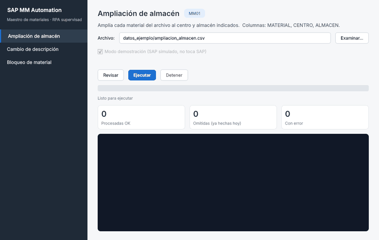
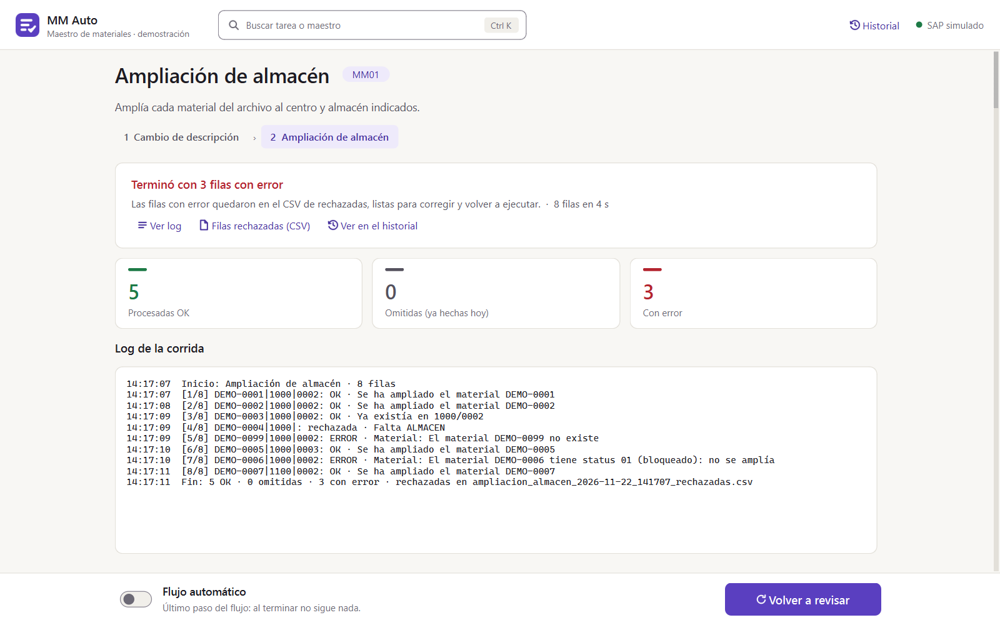
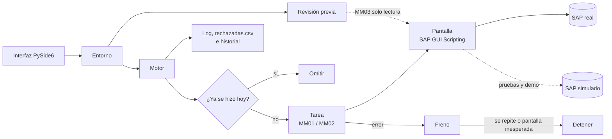

# SAP Material Master Automation

Automatización **supervisada** del maestro de materiales en SAP GUI con Python: la persona elige una tarea, revisa lo que va a pasar y ejecuta; el script hace en SAP los mismos pasos que haría a mano, con controles pensados para trabajar sobre un sistema productivo.




> **Proyecto de demostración escrito desde cero.** No contiene código, datos, configuraciones ni nombres de ninguna empresa. Los materiales, centros y almacenes son ficticios, y todo se puede probar sin SAP gracias al SAP simulado incluido.

## Qué incluye

| Tarea | Transacción | Qué hace |
|---|---|---|
| Cambio de descripción | MM02 | Reemplaza la descripción corta (máximo 40 caracteres). Si ya era igual, no graba |
| Ampliación de almacén | MM01 | Amplía cada material al centro y almacén indicados. Si ya existía, no graba nada |
| Bloqueo de material | MM02 | Asigna un status de material. No borra: se revierte quitando el status |

Las tareas se agrupan en procesos dentro de cada maestro de datos. **Mantenimiento diario** es un flujo de dos pasos en orden (descripciones y después ampliaciones); **Bloqueos** es una tarea suelta. Cada tarea lee un Excel o CSV y procesa fila por fila. Agregar una tarea nueva es crear una clase con sus columnas y sus pasos de SAP (`src/sap_mm_auto/tareas/`) y sumarla a un proceso en `catalogo.py`.

## La interfaz

| Pantalla | Qué muestra |
|---|---|
| **Barra superior** | Marca, buscador de tareas y maestros (**Ctrl+K**), acceso al historial, estado de SAP y la corrida en curso, visible desde cualquier pantalla |
| **Inicio** | Los maestros (Materiales, Proveedores, Clientes) con el estado del flujo de hoy, la conexión a SAP y el resumen del día |
| **Maestro** | Una pestaña por proceso; el flujo del día con cada paso hecho, fallido o pendiente, y las corridas recientes |
| **Tarea** | *Antes de ejecutar* con cada chequeo y su resultado, vista previa del archivo con los avisos en su fila, **Ejecutar** y el interruptor de **flujo automático** |
| **Corrida** | "3 de 8 · quedan 5", tiempo estimado, barra con un tramo por fila, log en vivo y **Detener**; al final, tarjetas de OK, omitidas y con error |
| **Historial** | Filtros Hoy / 7 días / Todo y Solo errores, búsqueda que también mira dentro de los logs, y el detalle de cada corrida con su log |



La paleta (*Tinta y violeta*) vive en un solo archivo, `ui/tema.py`, y las pruebas miden su contraste: cada color de texto pasa WCAG AA sobre los fondos donde se usa, y los bordes de controles y las marcas de la barra de avance, 3:1. Los íconos se dibujan con QPainter, sin archivos de imagen. Todo se maneja también con teclado: Ctrl+K, flechas, Enter y Esc para volver.

## Controles

- **Revisión antes de tocar SAP:** el archivo existe y no está abierto en Excel, tiene las columnas requeridas y no tiene filas repetidas, y SAP está en el menú inicial. Lo que impide ejecutar se marca *por corregir*; lo que conviene mirar, como *aviso*.
- **Avisos por fila en la vista previa:** filas incompletas (se rechazarán) y materiales que no existen o tienen un status de bloqueo, consultados en **MM03, que es solo de visualización**.
- **Usa la sesión que el usuario ya abrió:** no inicia sesión ni guarda credenciales; todo queda con su usuario y sus permisos.
- **Memoria diaria:** registra cada fila procesada al instante. Si la corrida se corta y se vuelve a lanzar, no repite lo que ya hizo.
- **Una fila con error no detiene la corrida:** queda en un `*_rechazadas.csv` con el motivo, listo para corregir y reprocesar.
- **Freno:** la corrida se detiene si el mismo error se repite tres veces seguidas, si SAP muestra una pantalla inesperada (y entonces no se toca nada más) o si la persona pulsa *Detener*.
- **Flujo automático con frenos:** al terminar bien un paso se abre el siguiente, se revisa y se ejecuta solo si no hay avisos. Cualquier error o aviso lo detiene. Empieza apagado en cada sesión.
- **Confirmación explícita** antes de modificar un SAP real, y otra al prender el flujo automático con SAP real.
- **Registro** de cada corrida (log, rechazadas e historial) con hora, fila, resultado y mensaje de SAP.

## Arquitectura



La interfaz solo habla con `Entorno`, que elige el SAP (real o simulado), revisa, corre el motor y guarda cada corrida en el historial. Las tareas nunca hablan con SAP directamente: usan la clase `Pantalla`, que recibe una sesión real (`win32com`) o el SAP simulado. Por eso el mismo código se prueba en cualquier sistema operativo y sin acceso a SAP, interfaz incluida.

## Probarlo sin SAP

```bash
git clone https://github.com/JeanPierreSP/sap-material-master-automation.git
cd sap-material-master-automation
python -m venv .venv
.venv/Scripts/python -m pip install -e ".[ui,dev]"     # Linux/macOS: .venv/bin/python

# Interfaz de escritorio en modo demostración (SAP simulado e historial de ejemplo)
python -m sap_mm_auto.ui

# Línea de comandos contra el SAP simulado
sap-mm-auto tareas
sap-mm-auto ejecutar ampliacion_almacen datos_ejemplo/ampliacion_almacen.csv --demo

# Pruebas (la interfaz se prueba sin pantalla)
python -m pytest

# Regrabar docs/demo.gif y docs/captura.png
python herramientas/grabar_demo.py
```

En la demostración, el archivo de ejemplo de la ampliación trae a propósito una fila incompleta, un material inexistente y uno bloqueado: la vista previa los avisa, la corrida los rechaza y el flujo automático se frena antes de ese paso.

## Usarlo con un SAP real

1. Windows con SAP GUI y **SAP GUI Scripting habilitado** en el servidor y en el cliente.
2. Instala la parte de Windows: `pip install -e ".[ui,windows]"`.
3. **Graba los IDs de tus pantallas** con el grabador de scripts de SAP GUI y reemplázalos en `src/sap_mm_auto/tareas/campos.py`. Los incluidos son de ejemplo: cada sistema puede tener otras subpantallas.
4. Prueba primero en un **sistema de calidad**, con pocas filas.
5. Abre SAP, deja la sesión en el menú inicial y ejecuta `python -m sap_mm_auto.ui --sap` (o la línea de comandos sin `--demo`). El programa pide confirmación antes de modificar nada.

## Estructura

```
src/sap_mm_auto/
├── sesion.py        Conexión a SAP GUI y operaciones de pantalla
├── controles.py     Memoria diaria, freno y precondiciones
├── motor.py         Bucle común con todos los controles
├── entrada.py       Lectura de Excel y CSV
├── registro.py      Log y archivo de rechazadas
├── historial.py     Corridas en JSONL, estado del día y filtros
├── vista_previa.py  Revisión antes de ejecutar: chequeos y avisos por fila
├── catalogo.py      Maestros, procesos y tareas; búsqueda para Ctrl+K
├── entorno.py       Lo único que ve la interfaz: SAP, motor e historial
├── simulador.py     SAP simulado para pruebas y demostración
├── tareas/          Una clase por tarea, consultas MM03 y campos.py con los IDs
└── ui/
    ├── tema.py      Paleta, tipografía y hoja de estilo (único archivo con colores)
    ├── glifos.py    Íconos y marca dibujados con QPainter
    ├── piezas.py    Tarjetas, pastillas, interruptor, barra por fila
    ├── ventana.py   Barra superior, navegación y corrida en curso
    ├── buscador.py  Ctrl+K
    ├── trabajador.py  Revisión y corridas en segundo plano
    └── vistas/      Inicio, maestro, tarea e historial
tests/               Pruebas automatizadas, también de cada pantalla
datos_ejemplo/       Archivos de entrada ficticios
herramientas/        Script que graba docs/demo.gif y docs/captura.png
```

## Decisiones de diseño

- **SAP GUI Scripting en lugar de BAPI o batch input:** no requiere desarrollos ni accesos adicionales en SAP y respeta los permisos de cada usuario. El costo es la dependencia del diseño de las pantallas; por eso los IDs viven en un solo archivo y cada cambio se valida contra el SAP simulado.
- **Supervisado, no desatendido:** una persona inicia cada corrida y ve el avance en vivo. Es más lento que un proceso nocturno, pero más seguro para datos maestros.
- **Revisar antes que corregir después:** la vista previa avisa lo que va a fallar antes de tocar SAP, con consultas de solo lectura. Un aviso no impide ejecutar, pero sí frena el flujo automático.
- **La interfaz no conoce SAP:** todo pasa por `Entorno`. Así cada pantalla se prueba sin pantalla y sin SAP, y cambiar el SAP simulado por el real es una sola decisión, al abrir.
- **Pruebas sin SAP:** el simulador reproduce los mensajes y errores típicos, de modo que cada cambio se comprueba antes de acercarse a un sistema real.

## Autor

**Jean Pierre Silverio Pantoja** · Datos maestros SAP y automatización con Python · [LinkedIn](https://www.linkedin.com/in/jeansilverio)

## Licencia

[MIT](LICENSE)
